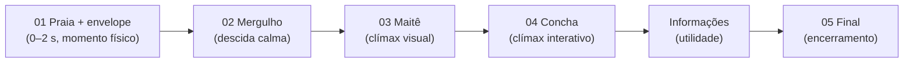

# Revisão artística da experiência completa (V1)

Revisão de 17/10/2026 sobre o commit local da Cena 04 (`4785753`; sem push nem deploy). A jornada foi percorrida como **narrativa contínua**, em Chrome headless com a prévia local (build de produção): mobile 390×844, tablet 820×1180 e desktop 1440×900, com a linha do tempo da abertura do envelope e a rolagem em passos de 0,35 tela. Capturas em `assets/_review/full-experience/` (fora do Git; folhas de contato `sheet-*.jpg`).

**Limites desta revisão.** É uma avaliação visual e de capturas em software (sem GPU, sem toque real): ritmo, fluidez e desempenho em aparelhos reais ficam para os testes manuais no celular e no tablet. Os "contrastes" citados são medianos sobre o retângulo do texto e servem só como indicador (a amostra inclui os pixels das letras); não substituem medição com ferramenta de acessibilidade.

## 1. Diagnóstico da jornada

**O que funciona (e deve ser preservado)**

- **Direção de arte coesa.** Paleta pastel de fundo do mar (azuis luminosos, rosas, lilases, pérolas) atravessa as quatro cenas; sprites, bolhas e fundos pertencem à mesma biblioteca e não brigam entre si. A Maitê no cavalo-marinho combina com os corais sem parecer colada.
- **Passagens contínuas.** Praia → mergulho (véu de água que usa a cor da cena seguinte), mergulho → Maitê → concha (mundo fixo com dissolução de quadro inteiro e câmera que avança) não têm faixa, corte duro nem salto de cor. Em nenhum quadro percorrido apareceu emenda.
- **Dois pontos altos claros.** A chegada da Maitê (personagem inteira, sorridente, no centro, sobre luz que vem de cima) e a pérola gigante com o botão "Revelar meu convite". O convite emerge numa moldura de pérolas e corais que lê como "presente aberto".
- **Texto legível em repouso.** Títulos em serifa escura sobre áreas claras da água (contraste mediano ≈ 7–10); corpo de texto 5,9–7,5; botão 9,7.

**O que enfraquece a narrativa**

- **Ritmo irregular.** Todo o "acontecimento físico" está nos primeiros 2 s (envelope). Depois vem uma descida longa e quase estática (Cena 02) antes do primeiro ponto alto (Maitê). A cena do mergulho tem 9 peixes SVG e 27 elementos decorativos, mas nada *acontece*: o olho não tem para onde ir.
- **Profundidade rasa na Cena 02.** O fundo claro, as plantas de primeiro plano e os raios de luz ficam em valores parecidos; a sensação de "descer" depende só do parallax. O texto de abertura cai sobre os raios mais claros (corpo ≈ 6, o menor da jornada em repouso).
- **Peixes pintados no fundo permanecem parados** enquanto os peixes SVG nadam ao lado: o contraste "vivo × congelado" denuncia o fundo. Coerente com a observação do operador (conferida a olho; não medida por camada).
- **Interrupção do arco no fim.** Quem rola sem abrir a concha chega ao encerramento ("Agora que você já sabe onde e quando…") sem ter visto o convite.
- **Informações em estilo neutro.** Os cartões de local, contagem, ações e presentes (brancos translúcidos) são a parte mais lida e a mais "de app" da jornada; destoam da moldura de pérolas logo acima.
- **Desktop é uma coluna.** No computador o mundo ocupa uma coluna de ~540 px sobre um fundo borrado e esticado da mesma arte; funciona como moldura, mas não aproveita a tela. Tablet preenche a largura sem problema (texto relativamente pequeno).

## 2. Problemas por cena

### Cena 01 — Praia e envelope
| ID | Observação | Evidência |
| --- | --- | --- |
| E1 | A abertura **não parece física**: o envelope fechado é trocado pelo aberto num *crossfade* de ~150–270 ms entre duas imagens de tamanho/inclinação diferentes; o brilho e as bolhas soltam logo depois e o "mergulho" (1,7 s) cobre o resto. Não há movimento de aba, nem pausa antes do clímax. | quadros `a00`–`a05` (mobile), `a00`–`a09` (desktop) |
| E2 | O botão "Abrir o envelope" some de imediato (some em ~200 ms), sem retorno de toque. | `a00`→`a01` |
| E3 | No desktop, o fundo lateral borrado salta de areia para água de uma vez, enquanto a coluna central faz a transição suave. | `a07`→`a09` (desktop) |

### Cena 02 — Mundo submarino
| ID | Observação | Evidência |
| --- | --- | --- |
| M1 | Contraste e profundidade: poucos degraus de valor entre fundo, meio e primeiro plano; falta névoa de distância, vinheta e luz diferenciando planos. | `b00` |
| M2 | Poucos acontecimentos: sem cardume coordenado, sem criatura de chão (siri), sem evento "narrativo" que conduza o olhar até a Maitê. | 9 peixes, 27 elementos, 1 canvas |
| M3 | Peixes pintados no fundo permanecem parados (relato do operador). Nas capturas `b00-t0`/`b00-t3s` eles só se deslocam junto com o plano inteiro (deriva da câmera), sem nadar por conta própria; a diferença entre os quadros é espalhada pela imagem toda, então **não** isolei a camada por medição. | `b00` |
| M4 | O corpo do texto de abertura ("Respire fundo…") cai sobre os raios claros; legível, mas é o ponto fraco. | `b00` |
| — | Não há sprite de siri na biblioteca inventariada (`docs/MAITE_ASSET_INTEGRATION.md`): precisaria de asset novo. | — |

### Cena 03 — Maitê
| ID | Observação | Evidência |
| --- | --- | --- |
| C1 | **Texto passando sobre o rosto** durante a rolagem: o título e o corpo ("Tenho um convite muito especial…") cruzam o rosto e o vestido (quadro `b02`). Em repouso o texto fica acima e legível. É transitório, mas é justamente o momento mais importante. | `b01`, `b02` |
| C2 | A chegada é correta, mas **sem um "beat"**: a personagem já está inteira no primeiro quadro. Falta uma pequena sinalização de chegada (luz que se abre, bolhas que a acompanham). | `b01` |
| C3 | Equilíbrio de iluminação bom: o rosa do vestido e do cavalo-marinho se destaca do azul sem halo artificial. | `03-maite` |

### Cena 04 — Concha e informações
| ID | Observação | Evidência |
| --- | --- | --- |
| K1 | Data longa ("domingo, 8 de novembro de 2026") encosta nos corais da moldura no desktop; no mobile quebra em duas linhas sem tocar. | `desktop-05-convite` |
| K2 | Cartões neutros destoam do ambiente (local, contagem, ações, presentes). O divisor de conchas já existe e não foi usado. | `05`–`08` |
| K3 | O encerramento aparece mesmo com a concha fechada e **diz "Agora que você já sabe onde e quando…"**. | `b07`–`b09` |
| K4 | Na chegada à concha o eyebrow pequeno ("Lá no fundo, uma grande concha guarda um segredo") cruza coral/areia e perde contraste (mediano ≈ 4) por alguns instantes; em repouso fica sobre água. | `b04`, `b05` |
| K5 | A saída da concha para o lilás do encerramento "corta" a borda inferior da concha com um degradê; é bonito, mas abrupto. | `b07` |
| K6 | Selos "A CONFIRMAR" e botões desabilitados são só da prévia e estão corretos para o propósito; a versão pública os omite. | — |

### Transições
Todas as quatro passagens parecem parte da mesma aventura. O ponto mais *cortante* é praia → mergulho (a imagem troca por completo atrás do véu), mas o véu usa a cor da cena seguinte e a mudança é motivada (a abertura do envelope). A passagem final (água → lilás) é a mais "de página" que "de aventura".

### Mobile × tablet × desktop
| | Mobile | Tablet | Desktop |
| --- | --- | --- | --- |
| Arte | Plena, é o alvo | Plena, preenche a largura | Coluna central + fundo borrado |
| Texto | Bom | Pequeno para o tamanho do mundo | Bom, mais folga |
| Moldura do convite | Íntegra | Íntegra | Data encosta (K1) |

## 3. Priorização

Escalas: impacto artístico (A/M/B), impacto na experiência (A/M/B), custo provável (S pequeno, M médio, G grande), risco de regressão (B/M/A), reutilização no Convite Vivo (A/M/B). **Não há P0 confirmado.** O único candidato a P0 é desempenho/aquecimento em celular real, **ainda não medido** (em software headless a cena de maior custo ficou em ~124 % de CPU, comparativo apenas): será decidido pelos seus testes manuais.

### P1 — melhorias visuais de grande impacto
| ID | Melhoria | Artístico | Experiência | Custo | Risco | Reuso |
| --- | --- | --- | --- | --- | --- | --- |
| E1 | **Abertura física do envelope**: sequência em batidas (levanta e inclina, aba/abertura com ponte de escala entre as duas imagens, luz que escapa, bolhas e faíscas), 0,9–1,3 s antes do mergulho, com resposta imediata ao toque. Sem asset novo; com reduced motion segue instantâneo. | A | A | M | B (isolado na cena de entrada) | A (toda abertura de convite) |
| M1 | **Contraste e profundidade da Cena 02**: névoa de distância, vinheta suave, separação de valores entre planos, luz diferenciando primeiro plano; reforço sutil de contraste do texto. | A | M | S | M (mexe em contraste do texto) | A (palco genérico) |
| M2a | **Cardume** coordenado (modo cardume no componente de peixes: grupo que atravessa, desvia, volta) e 1–2 "acontecimentos" que conduzam o olhar à Maitê. | A | A | M | M | A |
| M3 | **Peixes pintados parados**: decidir entre (a) cobri-los/acompanhá-los com peixes SVG nadando sobre eles, (b) leve distorção/ondulação no plano de fundo, (c) novo fundo sem peixes (asset). (a) é a única sem asset novo. | M | M | M (a) / G (c) | M | M |
| K2 | **Cartões do ambiente**: plaquinhas de concha, divisor, bordas de pérola nos cartões de local, contagem, ações e presentes; hierarquia mais clara (data > hora > local). | A | A | M | B | A (cartões genéricos) |
| K3 | **Coerência do encerramento**: o final só reconhece "onde e quando" depois que o painel foi aberto (ou o texto fica neutro quando fechado). | M | A | S | B | A |
| C1 | **Texto × rosto da Maitê**: o texto de abertura sai (ou desvanece) antes de cruzar o personagem; ou fica fora da zona do rosto durante toda a rolagem. | M | A | S | M | M |

### P2 — acabamentos e detalhes
| ID | Item | Custo |
| --- | --- | --- |
| C2 | Beat de chegada da Maitê (luz que se abre, bolhas acompanham) | S |
| K1 | Data em duas linhas / dia da semana abreviado na moldura | S |
| K4 | Eyebrow da concha com apoio de contraste na chegada | S |
| K5 | Saída da concha para o encerramento: mais gradual | S |
| E2 | Retorno de toque do botão do envelope antes de sumir | S |
| E3 | Fundo lateral do desktop acompanhar a transição | S |
| D1 | Desktop: aproveitar a largura (moldura mais larga ou composição lateral) | M |
| D2 | Tablet: escala do texto no mundo | S |
| M4 | Reforço de contraste do corpo do texto de abertura | S |
| — | **Siri na areia**: exige sprite novo (não há na biblioteca) — só entra com asset | M + asset |

### P3 — experimentos futuros (não implementar agora)
| Ideia | Observação |
| --- | --- |
| Vídeo ambiental curto em loop | Substituiria ou complementaria o fundo da Cena 02; custo de banda alto em celular; precisa de poster estático e *fallback*. |
| Vídeo + CSS/Canvas | Camada de vídeo atrás, elementos de interação em CSS/Canvas à frente; só vale se o vídeo tiver o mesmo estilo dos sprites. |
| Animações controladas pela rolagem | A câmera já responde à rolagem; "scrubbing" de elementos específicos (ex.: peixes ligados ao deslocamento) é incremental e barato, mas só depois de M1/M2a. |
| Objetos reagindo ao dedo | Bolhas que estouram ao toque, peixes que desviam: alto encanto, custo e risco de desempenho moderados. |
| Pequenas interações lúdicas | Ex.: tocar nas conchas do caminho para soltar faíscas; só depois de fechar o P1. |

## 4. Melhorias recomendadas (síntese)

1. **Fechar o arco narrativo antes de enfeitar**: K3 e C1 são pequenos, de baixo risco e corrigem duas quebras que o visitante percebe.
2. **Dar ao envelope o peso físico que a abertura merece** (E1) — é a primeira impressão e é a parte mais reutilizável do produto.
3. **Fazer a Cena 02 respirar**: profundidade (M1) + cardume e um acontecimento guia (M2a) resolvem o "longo corredor vazio" sem asset novo; M3 (peixes parados) fica com a solução (a) ou vira pedido de asset.
4. **Levar o estilo da moldura para as informações** (K2): é a maior diferença de acabamento entre o convite e o que vem depois.
5. Deixar P2 para uma passada de acabamento e P3 para depois que a família aprovar a V1.

## 5. Experimentos opcionais (sem compromisso)

- Tocar na concha da areia solta faíscas (reaproveita `Sparkles`).
- Peixe-guia: um peixe que sai do cardume e leva o olhar até a Maitê (reaproveita `Fish`).
- Bolhas que estouram ao toque na Cena 02 (Canvas já existente).
- Poster + vídeo curto como fundo opcional da Cena 02, com `prefers-reduced-motion` e conexão lenta caindo para a imagem.

## 6. Ordem sugerida da segunda passada

| # | Entrega | Por quê nessa ordem |
| --- | --- | --- |
| 1 | K3 + C1 (e K1 se couber) | Rápidos, seguros; deixam a V1 coerente |
| 2 | E1 — abertura física do envelope | Maior impacto na primeira impressão; isolado |
| 3 | M1 — profundidade e contraste da Cena 02 | Base para M2a e M3; mexe em contraste, então vem com teste visual |
| 4 | M2a + M3(a) — cardume, peixe-guia e peixes pintados | Usa a profundidade já resolvida |
| 5 | K2 — cartões do ambiente | Independente; pode ir em paralelo se houver tempo |
| 6 | P2 de acabamento + revisão em aparelhos reais | Só depois do essencial |
| 7 | Decidir P3 e pedidos de asset (siri, fundo sem peixes) | Depende do que a família e o operador aprovarem |

Cada passo termina com `verify`, capturas mobile/tablet/desktop e medição comparativa de custo; nenhum deles reescreve o renderer.

## 7. Critérios de aprovação artística

Uma entrega da segunda passada está aprovada quando:

1. **Narrativa:** em nenhuma sequência de rolagem o texto cobre o rosto da Maitê nem o encerramento contradiz o que o visitante viu.
2. **Abertura:** o toque no envelope tem resposta imediata e a abertura dura 0,9–1,3 s antes do mergulho; reduced motion continua instantâneo.
3. **Profundidade:** na Cena 02, três planos distintos de valor são identificáveis em captura estática; texto de corpo ≥ 4,5:1 em repouso.
4. **Vida:** nenhum elemento "vivo" (peixe, bolha) convive com um equivalente claramente parado no mesmo quadro; ao menos um acontecimento ambiental por tela de rolagem na Cena 02.
5. **Informações:** os cartões usam a mesma linguagem da moldura; data, hora e local aparecem inteiros, sem tocar ornamentos, em 360, 390, 820 e 1440 px.
6. **Continuidade:** nenhuma emenda, faixa ou salto de cor nas passagens 01→02→03→04→final.
7. **Regressão:** `npm run verify` e `npm run safety` verdes; custo comparativo (CPU/memória headless) sem piora acima de 15 %; sem dados da família pendentes no repositório.
8. **Aparelho real:** passa nos seus testes de toque no celular e no tablet (sem engasgos perceptíveis, sem aquecimento anormal em 2 minutos de uso).

## 8. Situação do repositório

Commit local `4785753` (Cena 04). O JSON versionado **não** contém horário, endereço nem presentes reais da família; eles ficam só na cópia local de trabalho (`private/`, ignorada, com `skip-worktree`), e os testes usam candidatos fictícios. Detalhes e decisões do primeiro push em `docs/PRIMEIRO_PUSH.md`.
